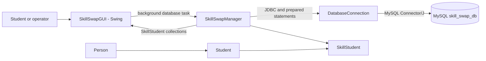
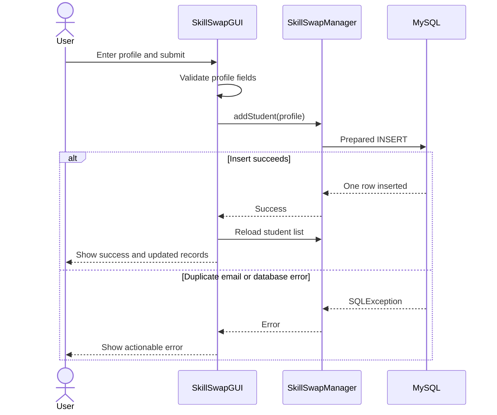
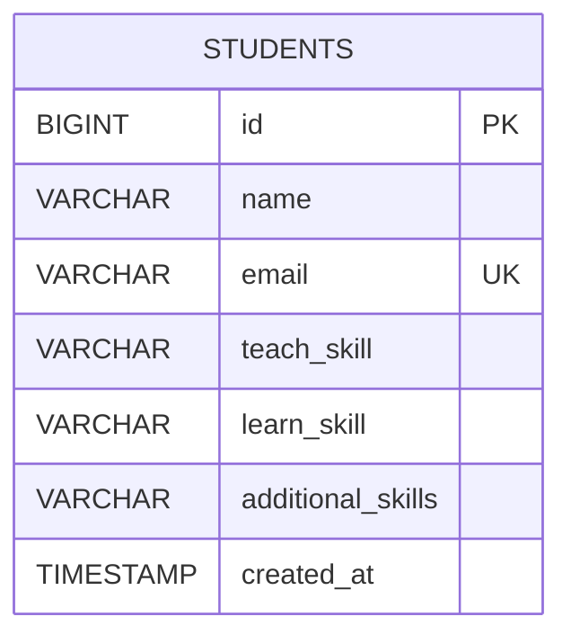
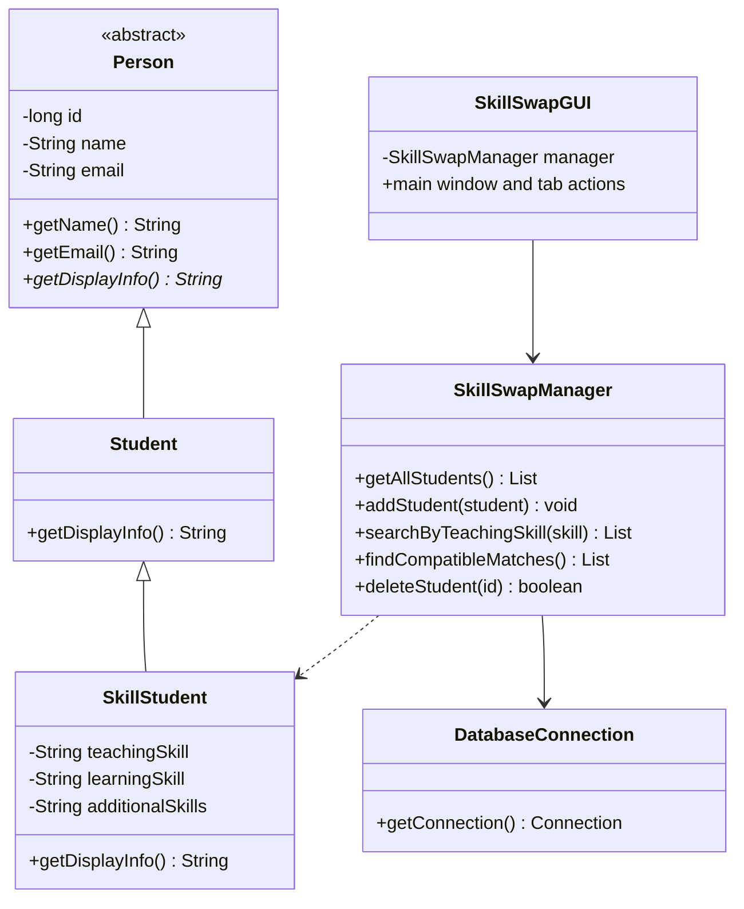

# Skill Swap Platform

## Project report

### Title page

**Project title:** Skill Swap Platform<br>
**Project type:** B.Tech Object-Oriented Programming microproject<br>
**Institution:** [Institution name]<br>
**Department:** [Department name]<br>
**Submitted by:** [Student name(s)]<br>
**Register number(s):** [Register number(s)]<br>
**Project guide:** [Guide name and designation]<br>
**Academic year:** [Academic year]

### Certificate

This is to certify that the project report entitled **“Skill Swap Platform”**
is submitted by **[student name(s), register number(s)]** in partial
fulfilment of the requirements for **[degree/programme]** during the academic
year **[academic year]**. The work was carried out under my supervision.

**Project guide:** ____________________<br>
**Head of department:** ____________________<br>
**Date:** ____________________<br>
**Place:** ____________________

> Replace this template with the certificate format prescribed by the
> institution.

### Acknowledgement

I/we thank **[institution name]**, **[department name]**, and
**[project guide name]** for their guidance and support. I/we also acknowledge
the authors and maintainers of Java, Apache Maven, MySQL, and MySQL Connector/J,
whose tools support this educational project.

## Abstract

Skill Swap Platform is a Java desktop application that helps students find
mutual opportunities to teach and learn skills. A student registers a name,
unique email address, one skill to teach, one skill to learn, and optional
additional skills. The application stores records in a MySQL database and
provides a Swing interface to register students, search by teaching skill,
identify reciprocal skill exchanges, view student records, and remove a
selected record after confirmation.

The project demonstrates object-oriented programming through an abstract
`Person` class, the `Student` and `SkillStudent` inheritance hierarchy,
encapsulated fields, overridden display methods, and collections used to
process database results. JDBC prepared statements and try-with-resources are
used for database operations. Database credentials are read from environment
variables rather than stored in source code.

## 1. Introduction

Students often have useful skills to share but may not know which peers can
teach the skills they want to learn. A reciprocal exchange is one in which
each participant can teach what the other participant wants to learn.

This project provides a small local application for recording student skills
and finding such exchanges. It is intended as a B.Tech demonstration of Java
OOP, Swing, JDBC, SQL, and basic software testing, rather than as a production
student-management system.

### 1.1 Problem statement

Without a shared directory, students must rely on informal communication to
find someone whose teaching skills match their learning goals. Manually
comparing lists is inconvenient and does not provide a persistent, searchable
record.

### 1.2 Objectives

- Record students and their teaching, learning, and optional additional skills.
- Prevent blank required fields, malformed email addresses, and duplicate
  email registrations.
- Search student records by teaching skill without case sensitivity.
- Find reciprocal skill-exchange pairs.
- Display and refresh persisted student records.
- Allow a user to delete a selected record only after confirmation.
- Demonstrate OOP, collections, exception handling, and safe JDBC practices.

### 1.3 Scope

The application is a single-user desktop program connected to a local MySQL
server. It supports manually entered student profiles and basic skill
matching. Authentication, remote hosting, messaging, scheduling, and
multi-user access control are outside the current project scope.

### 1.4 Proposed solution

The Swing interface collects user actions and delegates persistence and record
retrieval to `SkillSwapManager`. The manager uses `DatabaseConnection` to open
short-lived JDBC connections to `skill_swap_db`. MySQL enforces unique email
addresses, while Java validates profile fields and calculates reciprocal
matches from the retrieved records.

## 2. Requirements

### 2.1 Functional requirements

| ID | Requirement |
|---|---|
| FR-01 | Register a student with a name, valid email, teaching skill, learning skill, and optional additional skills. |
| FR-02 | Offer predefined skills and allow custom skill entry. |
| FR-03 | Reject blank required fields and malformed email addresses. |
| FR-04 | Reject a duplicate email with a user-friendly message. |
| FR-05 | Search records by teaching skill, ignoring case. |
| FR-06 | Find pairs where each distinct student teaches the skill the other wants. |
| FR-07 | Show all stored student records and refresh the view. |
| FR-08 | Delete only a selected record after explicit confirmation. |
| FR-09 | Preserve records in MySQL across application restarts. |
| FR-10 | Report database failures instead of presenting failed operations as successful. |

### 2.2 Non-functional requirements

- **Usability:** Provide a straightforward desktop interface with task-oriented
  tabs and clear validation/error messages.
- **Reliability:** Use database constraints and handle JDBC exceptions.
- **Security:** Keep passwords out of source, SQL scripts, and version control;
  bind SQL values through prepared statements.
- **Maintainability:** Separate the model, database manager, connection
  configuration, and GUI responsibilities.
- **Responsiveness:** Perform database operations in Swing background workers
  so ordinary database latency does not block the event-dispatch thread.
- **Portability:** Target Java 17 and use Maven to resolve dependencies.

### 2.3 Hardware requirements

- Windows 11 PC capable of running a Java 17 desktop application.
- RAM and storage sufficient for the operating system, JDK, Maven, and local
  MySQL Server. No specialized hardware is required.

### 2.4 Software requirements

| Component | Purpose |
|---|---|
| Java Development Kit 17 | Compile and run the application |
| Apache Maven | Build, dependency management, and test execution |
| MySQL Server 8 | Persistent student record storage |
| MySQL Connector/J 8.4.0 | JDBC driver |
| Java Swing | Desktop user interface |
| VS Code (optional) | Editing and running the project |

## 3. System design

### 3.1 Architecture



The GUI submits database work off the Swing event-dispatch thread and updates
the interface when each task completes. The manager owns SQL and matching
logic. The connection helper reads local credentials and opens a JDBC
connection. The model classes represent people and skill profiles.

### 3.2 Use cases

| Use case | Main actor | Description | Expected result |
|---|---|---|---|
| Register student | Operator | Enter profile fields and submit. | Valid unique profile is stored and the student list refreshed. |
| Search by skill | Operator | Enter or select a teaching skill. | Matching records appear; invalid or empty searches are rejected. |
| Find exchange | Operator | Request compatible exchanges. | Each distinct reciprocal pair appears once. |
| View records | Operator | Open Manage Students or refresh the dashboard. | Stored records and count are displayed. |
| Delete student | Operator | Select a row and confirm deletion. | Only that student's record is removed; cancellation changes nothing. |

### 3.3 Registration flow



## 4. Database design

### 4.1 Database and table

The schema script creates the database if absent, then creates the `students`
table if absent. It does not drop the database or table. The unique constraint
on `email` prevents duplicate addresses. Fixed sample email addresses and an
upsert make the sample inserts safe to rerun without creating additional
copies.



### 4.2 Data dictionary

| Column | Type | Constraints / meaning |
|---|---|---|
| `id` | `BIGINT` | Auto-increment primary key |
| `name` | `VARCHAR(100)` | Required student display name |
| `email` | `VARCHAR(254)` | Required unique email address |
| `teach_skill` | `VARCHAR(120)` | Required skill the student can teach |
| `learn_skill` | `VARCHAR(120)` | Required skill the student wants to learn |
| `additional_skills` | `VARCHAR(500)` | Optional comma-separated skills; defaults to empty text |
| `created_at` | `TIMESTAMP` | Creation time, assigned by MySQL |

The Java queries and result lookups use the existing table names
`teach_skill` and `learn_skill`.

### 4.3 Safe database inspection

After connecting to the intended MySQL server and selecting `skill_swap_db`,
run these read-only statements in MySQL Workbench to inspect the actual schema
and current records:

```sql
USE skill_swap_db;
SHOW COLUMNS FROM students;
SELECT id, name, email, teach_skill, learn_skill, additional_skills
FROM students
ORDER BY name, id;
```

Compare the column names and types with the data dictionary above before
running a schema update. If an existing installation differs, back up the
database and plan a targeted `ALTER TABLE` migration after reviewing its
current data. Do not drop or recreate the table as a troubleshooting shortcut.

### 4.4 Fictional demonstration profiles

`database/sample_students.sql` contains ten fictional profiles with
`example.com` addresses. Its `INSERT IGNORE` statement runs within a
transaction: a sample email already in use is skipped without changing the
existing profile. The script reports inserted and skipped counts, lists matching
sample emails, and returns a separate discrepancy result set for any existing
sample profile whose name or skills differ from the expected fictional data.
It also queries reciprocal matches among the sample profiles. The seed script
has not been executed against the live database in this environment, so actual
insert and skip counts and database match results remain unverified.

The five designed exchange pairs are:

| Pair | Student A teaches / wants | Student B teaches / wants |
|---|---|---|
| 1 | Java / Python | Python / Java |
| 2 | Web Development / UI/UX Design | UI/UX Design / Web Development |
| 3 | SQL / Excel | Excel / SQL |
| 4 | HTML / CSS | CSS / HTML |
| 5 | Data Science / Machine Learning | Machine Learning / Data Science |

## 5. Implementation and OOP

### 5.1 Class responsibilities



### 5.2 OOP concepts demonstrated

- **Encapsulation:** Model fields are private and accessed through getters and
  validated setters.
- **Abstraction:** `Person` is abstract and defines the common identity and
  display contract.
- **Inheritance:** `Student` extends `Person`, and `SkillStudent` extends
  `Student`.
- **Overriding and polymorphism:** `Student` and `SkillStudent` implement
  `getDisplayInfo()`; calling the method through a parent type dispatches to
  the concrete implementation.
- **Constructors and object creation:** Database rows and form submissions
  create `SkillStudent` objects using constructors.
- **Collections:** The manager uses lists for query results and possible
  exchange pairs.
- **Exception handling:** Model validation reports `IllegalArgumentException`;
  JDBC failures use `SQLException`; the GUI distinguishes duplicate-email
  errors and reports other database failures.
- **JDBC:** Prepared statements bind profile values, and connections,
  statements, and result sets are closed using try-with-resources.

### 5.3 Reciprocal matching algorithm

The manager loads distinct database rows and compares each pair using nested
loops. A pair is added only when both conditions are true:

1. The first student's teaching skill equals the second student's learning
   skill.
2. The second student's teaching skill equals the first student's learning
   skill.

Skill comparison ignores letter case and surrounding whitespace. The inner
loop starts after the first student's index, so a student is never compared
with themself and each pair is considered only once.

### 5.4 Database configuration and error handling

`DatabaseConnection` uses
`jdbc:mysql://localhost:3306/skill_swap_db?serverTimezone=UTC` by default.
`SKILLSWAP_DB_USER` and `SKILLSWAP_DB_PASSWORD` are read from the process
environment; an optional `SKILLSWAP_DB_URL` can override the URL. No password
is included in this report or source code. Missing credentials and JDBC
connection failures are surfaced to the GUI instead of being treated as
successful operations.

## 6. Build, run, and test

### 6.1 Commands

Open the project root in VS Code, then use its PowerShell terminal:

```powershell
mvn clean compile
mvn test
mvn exec:java
```

Before running, verify the `MySQL80` service is running, the schema exists,
and the two credential environment variables are set in the terminal or
Windows user environment. Do not put credential values in the repository.

### 6.2 Automated tests

Automated unit tests cover:

- Trimming valid student profile fields.
- Rejecting blank required fields and malformed email addresses.
- Detecting case-insensitive reciprocal matches exactly once.
- Excluding self-matches and returning no pairs for an empty student list.

These unit tests do not require a live MySQL server. They do not prove
registration, search, deletion, or persistence against a real database; those
require integration/manual tests with the configured MySQL account.

### 6.3 Manual acceptance checklist

Run the GUI with `mvn exec:java` and verify each item against a test profile
that you create and can safely remove:

- [ ] Dashboard count agrees with the number of rows shown in Workbench.
- [ ] Registration accepts valid predefined and custom skills.
- [ ] Blank required fields and malformed email addresses show validation
  messages.
- [ ] Reusing an existing email shows a duplicate-email message.
- [ ] Successful registration appears in the student table and survives an
  application restart.
- [ ] Search finds teaching skills regardless of letter case; empty and
  no-result searches are handled clearly.
- [ ] Reciprocal profiles appear once as a pair; a profile does not match
  itself.
- [ ] Cancelling deletion preserves a record; confirming deletion removes only
  the selected test record.
- [ ] A database outage or invalid connection produces an error message rather
  than a false success.

Never use an existing student record as a disposable test record.

### 6.4 Test evidence

Record only tests actually executed in the final submission. Fill the table
after running the commands and manual checks in the target environment.

| Test | Result | Evidence / notes |
|---|---|---|
| `mvn clean compile` | Passed | Java 17; all 7 main source files compiled. |
| `mvn clean test` | Passed | 9 tests; 0 failures, 0 errors, 0 skipped. |
| Live MySQL connectivity | Not run | The MySQL80 service was running, but the database credential environment variables were not available to the build process. |
| GUI acceptance checklist | Not run | Interactive registration, search, matching, deletion, and restart checks remain manual. |
| Sample profile SQL execution | Not run | The SQL is prepared; actual insert/skip counts and existing-profile discrepancies are unknown. |

### 6.5 GUI screenshots

No screenshots of a running GUI are included. Capture genuine screenshots on
the configured computer after loading sample data and verifying the displayed
results. In Windows, open each GUI tab, press **Win+Shift+S**, select the
application window area, then save the capture under `docs/screenshots/`.
Suggested filenames are `dashboard.png`, `register-student.png`,
`search-skills.png`, `find-matches.png`, and `manage-students.png`. Do not
include password prompts or secret values. Add report image links only after
the corresponding screenshots have actually been saved.

## 7. Limitations and future enhancements

- The application connects to a local MySQL service and assumes the expected
  database/table schema already exists.
- Search is a teaching-skill text search, not a recommendation engine.
- Matching checks exact skill names ignoring case; synonyms such as “JS” and
  “JavaScript” are not treated as equivalent.
- Profiles are managed locally; authentication, authorization, remote
  deployment, messaging, and scheduling are not implemented.
- Future work could add synonym-aware search, profile editing, configurable
  skill categories, and integration tests against an isolated test database.

## 8. Conclusion

Skill Swap Platform demonstrates how a Java Swing interface can work with an
object-oriented domain model and persistent MySQL storage. Students can record
skills, search for people who teach them, and find reciprocal exchanges. The
project also illustrates input validation, unique database constraints,
prepared statements, exception handling, collection processing, and
background database work. The acceptance checklist should be completed on the
target computer before making claims about live MySQL or GUI behavior.

## References

1. Oracle, *Java Platform, Standard Edition Documentation*,
   https://docs.oracle.com/en/java/javase/17/
2. Apache Maven, *Maven Documentation*, https://maven.apache.org/guides/
3. MySQL, *MySQL 8.0 Reference Manual*, https://dev.mysql.com/doc/refman/8.0/en/
4. MySQL, *Connector/J Developer Guide*,
   https://dev.mysql.com/doc/connector-j/en/
